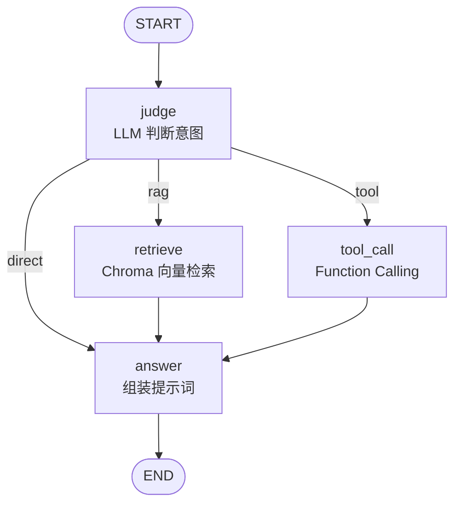

# Agentic-RAG Demo

用 **LangGraph 状态机**实现的 Agentic-RAG 示例：让 Agent 自主判断一个问题该走「检索知识库」、「调用工具」还是「直接回答」，而不是无脑套一条固定 RAG 流水线。

- 检索分支接 **Chroma 向量库**，语料从 `data/` 目录按段落切块后按语义相似度召回 Top-K，并在回答里标注引用来源（`文件名#段号`）
- 工具分支走**真实 Function Calling**（`bind_tools`），不是让模型用提示词"心算"
- 检索层带**中文词面重排**与**索引内容指纹**：语料改了会自动重建，改措辞但条数不变也不会漏更新
- 无 API key 也能跑通检索层、评测脚本与测试（Chroma 用本地 ONNX embedding 模型）

## 它和普通 RAG 的区别

普通 RAG 是单向管道：`问题 → 检索 → 拼上下文 → 生成`，**不管问题需不需要检索**。

这个项目在检索前加了一个 **judge 判断节点**，由大模型决定路由；需要算数或取时间时，走 Function Calling 真正调用工具。

## 状态图



程序启动时会打印由 LangGraph 导出的真实图结构：

```python
app.get_graph().draw_mermaid()
```

## 核心实现

### 1. judge：路由决策 + 输出校验

judge 只允许模型输出一个单词：

```python
raw = resp.content
action = normalize_action(raw)   # 规整为 rag / tool / direct
if action is None:
    action = "direct"            # 兜底，但会带上 warning 打印出来
    warning = f"judge 返回了无法识别的决策 {raw!r}"
```

`normalize_action()` 会去掉引号、空白和句读，并容忍模型多输出一句话（取其中第一个合法动作词）。**识别不了时不会静默降级**——主循环会把 warning 打出来，方便定位是提示词问题还是模型问题。

路由用 LangGraph 的条件边实现，未知值一律落到 `answer`：

```python
workflow.add_conditional_edges(
    "judge", route_func,
    {"retrieve": "retrieve", "tool_call": "tool_call", "answer": "answer"},
)
```

### 2. retrieve：目录化语料 + 向量召回 + 中文词面重排

**语料不再写死在代码里**：`src/documents.py` 递归扫描 `data/`，支持 `.md` / `.txt` / `.docx` / `.pdf`（docx、pdf 依赖按需导入，缺失时跳过该文件而不是崩掉）。切分策略是「先按空行分段，超长段落再按 400 字窗口 + 50 字重叠切」，每个片段的 id 形如 `员工手册.md#03`，直接当引用编号用。`data/` 为空时回退到内置的 12 条演示知识点，保证 clone 下来就能跑。

**索引按内容指纹重建**，而不是只比条数：

```python
fingerprint = sha256(embedding_identity + collection + 每条 id/text)  # 取前 16 位
if manifest["fingerprint"] == fingerprint and size == len(ids):
    return                      # 指纹没变才跳过
```

所以改了一条知识点的措辞、删了一个文件、换了 embedding 模型，都会触发重建；重建走 `upsert` + 清理历史 id，幂等且不会留下已删除片段的残影。清单写在 `.chroma/kb_manifest.json`（派生数据，不入库）。

**检索是「向量 + 中文词面」两段式**。默认 embedding 是英文语料训练的 `all-MiniLM-L6-v2`，中文语义召回偏弱，所以在向量分之上叠了一层字符 bigram 覆盖率（不需要新模型、新依赖）：

```python
pool = max(top_k, RERANK_POOL)          # 先多召回一些候选
score = (1 - LEXICAL_WEIGHT) * cosine + LEXICAL_WEIGHT * bigram_coverage(query, doc)
```

实测 recall@3 从 **65% 提到 85%**（20 条人工标注 query，数据见 [`BENCHMARK.md`](BENCHMARK.md)）。召回片段会拼成带来源标记的上下文，回答时要求模型用 `[来源: 文件名#段号]` 标注依据：

```python
context = "\n".join(f"[{c.source}] {c.text}" for c in chunks)
```

**embedding 实例在进程内复用**（`lru_cache` 单例）。chromadb 的 `DefaultEmbeddingFunction.__call__` 每次调用都会新建一个 `ONNXMiniLM_L6_V2()`，而 ONNX 会话挂在实例的 `cached_property` 上——等于每次检索都重新加载一遍模型。实测单次检索 p50 从 541 ms 降到 17 ms。

### 3. tool_call：Function Calling 而非提示词模拟

工具用标准 OpenAI function 描述定义，交给 `bind_tools`：

```python
resp = llm.bind_tools(TOOL_SCHEMAS).invoke(messages)   # 模型输出 tool_calls
```

当前注册两个工具：

| 工具 | 作用 |
|---|---|
| `calculator` | 四则运算，除零返回明确错误 |
| `get_current_time` | 获取系统当前时间 |

一次响应里的**所有** `tool_calls` 都会被依次执行；工具名未知或参数不合法时返回可读的错误文本，而不是抛异常。模型没有选择调用工具时，answer 节点会明确说明拿不到工具结果，而不是拿空字符串硬编。

### 4. answer：三条分支共用

按 `action` 组装不同提示词。检索分支如果没召回任何片段、工具分支如果没拿到结果，都会**直接给出"无法回答"**，不进入生成环节。

## 快速开始

需要 Python >= 3.10。

```bash
git clone https://github.com/Shui1Jiao/agentic-rag-demo.git
cd agentic-rag-demo

python -m venv .venv
# Windows
.venv\Scripts\activate
# macOS / Linux
source .venv/bin/activate

pip install -r requirements.txt

# 配置密钥
cp .env.example .env        # Windows: copy .env.example .env
# 编辑 .env，填入 DEEPSEEK_API_KEY

python -m src.main
```

启动后会先打印状态图的 Mermaid 代码、扫描 `data/` 并报告索引是否重建，然后进入交互循环。输入问题即可，输入 `exit` 退出。

把要检索的文档丢进 `data/`（支持 `.md` / `.txt` / `.docx` / `.pdf`），下次启动会自动按内容指纹重建索引。启动日志会说明：扫了几个文件、跳过了哪些及原因、切出几条片段、是否重建、耗时多少。

> **首次运行会下载 embedding 模型**（约 86MB，缓存到本地后不再重复下载），需要联网。
> 想完全离线：把 `all-MiniLM-L6-v2` 的 ONNX 模型放到 `models/all-MiniLM-L6-v2/onnx/`（与 chromadb 缓存结构一致），`src/local_embedding.py` 会自动改用项目内模型、不再联网。`models/` 体积大，已被 `.gitignore` 排除。

每次回答会同时打印 `thought`、`action`、引用来源、检索到的上下文、工具执行结果和最终回答——方便观察 Agent 到底走了哪条分支。

### 环境变量

| 变量 | 必填 | 默认值 | 说明 |
|---|---|---|---|
| `DEEPSEEK_API_KEY` | 是 | 无 | DeepSeek API 密钥 |
| `DEEPSEEK_MODEL` | 否 | `deepseek-chat` | 模型名，官方调整命名时改这里即可，不用动代码 |
| `DEEPSEEK_BASE_URL` | 否 | `https://api.deepseek.com/v1` | 接口地址 |
| `RAG_LOG` | 否 | `1` | 设成 `0` 关闭知识库启动日志（评测/CI 里用） |

## 测试与评测

检索层与路由逻辑的测试不需要 API key：

```bash
pip install -e ".[dev]"
python -m pytest tests -q          # 8 个用例，全部离线
```

检索质量与延迟用仓库内的标注集跑，同样不含 LLM 调用：

```bash
python bench/retrieval_eval.py baseline   # 纯向量
python bench/retrieval_eval.py hybrid     # 向量 + 中文词面重排
```

20 条人工标注 query 上的结果（详见 [`BENCHMARK.md`](BENCHMARK.md)）：

| 模式 | recall@3 | MRR@3 | p50 |
|---|---|---|---|
| 纯向量 | 65.0%（13/20） | 0.550 | 17.1 ms |
| 向量 + 词面重排 | **85.0%（17/20）** | 0.825 | 18.3 ms |

## 目录结构

```text
agentic-rag-demo/
├── src/
│   ├── __init__.py
│   ├── main.py              # 状态图、工具定义、四个节点、交互主循环
│   ├── retriever.py         # 索引构建（内容指纹）、混合召回、来源标注
│   ├── documents.py         # data/ 扫描与切分（md/txt/docx/pdf）
│   └── local_embedding.py   # 可选：改用项目内 ONNX 模型，完全离线
├── data/                    # 你的知识库文档（丢文件进来即可）
├── bench/
│   └── retrieval_eval.py    # 20 条标注集的 recall/MRR/延迟评测
├── tools/
│   ├── dump_corpus.py       # 导出当前语料快照（corpus.json / corpus.txt）
│   └── export_graph.py      # 导出状态图（graph.mmd / graph.png）
├── tests/
│   └── test_smoke.py        # 检索层、切分、指纹、路由逻辑冒烟测试
├── BENCHMARK.md             # 实测数据：测试覆盖、召回率、延迟修复对照
├── .env.example
├── requirements.txt
├── pyproject.toml
├── LICENSE
└── README.md
```

## 已知限制

- `data/` 里是 3 份演示文档（含一份 docx），覆盖度有限；`data/` 清空时会回退到 12 条内置知识点，**不是真实业务知识库**。
- 重排是字符 bigram 的启发式，不是模型 rerank；同义改写（字面完全不重合）时它帮不上忙。
- 只在几十到几百条片段的规模上验证过；上千条时没有分片/批量写入优化，也没有压力测试。
- 检索分支的拒答判断只基于「是否召回片段」，没有做相关性阈值过滤——相似度很低时仍会拿片段去回答。
- judge 路由是 LLM 决策，目前只校验输出是否落在 `rag/tool/direct` 里，**没有量化路由准确率**（既有标注集只标了检索真值）。

## 后续可做

- 用 `.with_structured_output()` 把 judge 的决策约束成枚举，比字符串校验更稳，并补一份路由标注集量准确率。
- 检索分支增加相似度阈值过滤与模型级 rerank，替换掉字符 bigram 启发式。
- 支持多轮对话（把历史写进 LangGraph 状态并加 checkpointer）。
